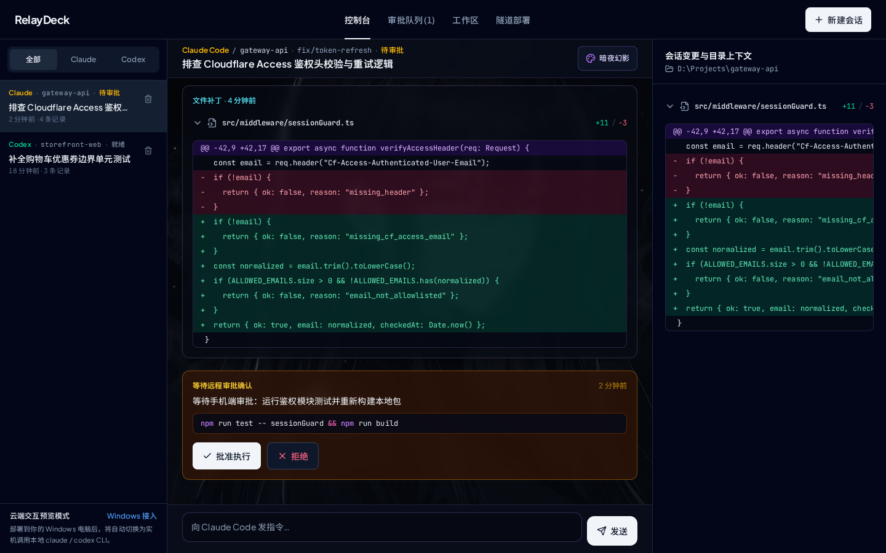
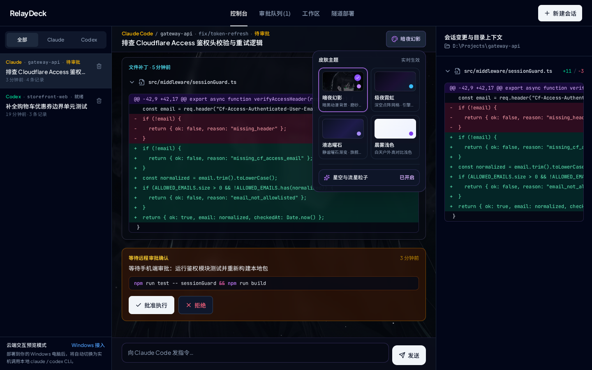
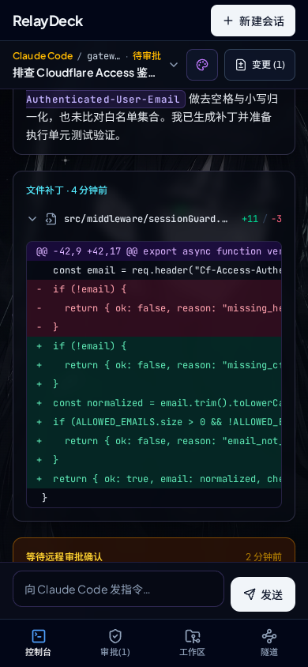

# RelayDeck

> **手机 + 桌面全栈远程控制台**：随时随地安全驱动 **Claude Code CLI** 与 **OpenAI Codex CLI**，支持「家里电脑 + 24h 云端服务器」双节点无缝切换、多套暗夜主题与星空流星动效、原生 Android APK 打包，以及 Windows CC Switch 模型/密钥自动同步到 Linux 云端。


---

## ✨ 界面预览

### 桌面端控制台 & 四套主题切换
<table>
  <tr>
    <td width="50%">
      
      <p align="center"><b>暗夜幻影默认主题</b> · 实时 Diff 审阅、高危命令审批与多色语法高亮</p>
    </td>
    <td width="50%">
      
      <p align="center"><b>4 套皮肤一键切换</b> · 暗夜幻影 / 极夜霓虹 / 液态曜石 / 晨雾浅色 + 流星开关</p>
    </td>
  </tr>
</table>

### 移动端实机布局（适配原生 APK / PWA）
<p align="center">
  
</p>

---

## 🚀 核心特性

- **双智能体统一调度**：原生驱动本机或服务器上的 `claude`（Claude Code CLI）与 `codex`（`@openai/codex` CLI），通过 UTF-8 标准输入流传递中文指令与多行提示词，SSE 实时流式回传思考进度、工具调用与回复内容。
- **一机双节点无缝切换**：配套轻量原生 Android 外壳（`android-app/`），顶部集成 **`24h 云端`** / **`家里电脑`** 独立双 WebView 切换条，不丢会话位置；电脑关机时可一键切到云服务器继续干活。
- **高颜值可读性体验**：内置 4 套主题皮肤、HTML5 Canvas 闪烁星空与斜向流星动画（后台自动暂停省电、尊重系统减弱动效设置），以及轻量级 Markdown & 代码多色词法高亮器。
- **工程级安全防线**：
  - 工作区路径围栏：拒绝相对路径、`..` 目录穿越及系统根目录（如 `C:\Windows`、`/`、`/etc`）。
  - 命令风险分级：自动识别高危命令（`rm -rf`、`git push --force`、`del /s` 等）并要求远程审批，每次任务结束自动抓取 `git diff` 供手机审阅。
  - 双层零信任保护：适配 **Cloudflare Tunnel + Zero Trust Access**（免公网 IP、免开放端口），后端可选二次校验 `CF_ACCESS_ALLOWED_EMAIL` 与 `BRIDGE_AUTH_TOKEN`。
- **Windows CC Switch → Linux 云端自动同步**：自带 PowerShell 一键同步与 **2 秒防抖自动监听** 脚本（`scripts/`），在 Windows 切换模型或更换 API 密钥后自动通过加密 HTTPS 同步至 Linux 云端，并**自动清洗 Windows 专属路径**（`C:\...`、`.exe`、`node_repl`、`sandbox = "elevated"` 等），写完即生效无需重启服务。

---

## 🏗️ 架构一览

```text
📱 手机端 (原生 Android APK / 手机浏览器)
        │  HTTPS + Cloudflare Access (邮箱一次性验证码)
        ▼
☁️ Cloudflare Tunnel (无需公网 IP / 无需开放服务器端口)
        │
        ├──► 💻 家里电脑 (Windows / macOS)  ──► 调用本地 claude / codex 操作本机项目
        │           │
        │           │  (可选) scripts/sync-to-cloud-watch.bat
        │           │  HTTPS + Service Token + BRIDGE_SYNC_SECRET
        │           ▼
        └──► ☁️ 24h Linux 云服务器 (systemd) ──► 调用云端 claude / codex (自动清洗配置)
```

---

## ⚡ 快速开始（3 分钟本地运行）

### 1. 环境准备
- **Node.js 22+**（Windows 可执行 `winget install OpenJS.NodeJS.LTS`）
- 至少安装以下任一命令行工具并确保在 `PATH` 中可用：
  - **Claude Code CLI**：确认终端可运行 `claude --version`
  - **OpenAI Codex CLI**：执行 `npm install -g @openai/codex`，确认可运行 `codex --version`

> 未安装本地 CLI 时，RelayDeck 会自动以「交互预览模式」启动，方便先体验完整 UI 与审批流程。

### 2. 克隆与启动
```bash
git clone https://github.com/<你的用户名>/relaydeck.git
cd relaydeck
npm install
npm run dev
```

打开浏览器访问 `http://127.0.0.1:3000`：
1. 进入顶部 **「工作区」**，添加你电脑上的真实项目目录（例如 `D:\Projects\my-app` 或 `/home/ubuntu/workspace`）。
2. 点击 **「+ 新建会话」**，选择 **Claude Code** 或 **Codex**，即可直接下发任务。

---

## 🌐 进阶部署指南

### A. 远程安全访问（Cloudflare Tunnel + Zero Trust Access）

无需公网 IP，也无需在路由器做端口映射：

1. 将任意支持托管 NS 的域名（如 `example.com` 或 `yourname.ggff.net`）接入 **Cloudflare Free** 计划。
2. 进入 **Cloudflare Zero Trust → Networks → Tunnels → Create a tunnel**：
   - 按向导在你的电脑或服务器上安装 `cloudflared` 客户端。
   - 添加 **Public Hostname**：例如 `agent.example.com` 指向 `http://127.0.0.1:3000`（如果部署在云服务器，可再配一条 `cloud.example.com` 指向 `http://127.0.0.1:3010`）。
3. **开启身份门禁（强烈建议）**：
   - 进入 **Zero Trust → Access → Applications → Add an application（Self-hosted）**，保护你的子域名。
   - 添加 **Allow** 策略，仅放行你的个人邮箱（使用 **One-time PIN** 一次性验证码登录）。
4. 复制 `.env.example` 为 `.env`，按需启用后端二次校验：
   ```env
   PORT=3000
   BRIDGE_EXEC_MODE=live
   CF_ACCESS_ALLOWED_EMAIL=you@example.com
   ```

---

### B. 24 小时 Linux 云端部署（Ubuntu + systemd）

如果你有一台长期在线的 Linux 云服务器（如 AWS EC2 / 轻量应用服务器）：

```bash
git clone https://github.com/<你的用户名>/relaydeck.git ~/relaydeck
cd ~/relaydeck
npm install
npm run build
mkdir -p ~/workspace
```

创建 systemd 守护服务 `/etc/systemd/system/relaydeck.service`（端口可按需修改，例如 `3010`，避免与其他服务冲突）：

```ini
[Unit]
Description=RelayDeck Cloud Bridge Server
After=network.target

[Service]
Type=simple
User=ubuntu
WorkingDirectory=/home/ubuntu/relaydeck
Environment=NODE_ENV=production
Environment=PORT=3010
Environment=PATH=/usr/local/sbin:/usr/local/bin:/usr/sbin:/usr/bin:/sbin:/bin
ExecStart=/home/ubuntu/relaydeck/node_modules/.bin/tsx /home/ubuntu/relaydeck/server.ts
Restart=always
RestartSec=3

[Install]
WantedBy=multi-user.target
```

启用并启动服务：
```bash
sudo systemctl daemon-reload
sudo systemctl enable --now relaydeck
```

---

### C. 编译专属原生 Android APK（无需本机安装 Android Studio）

仓库内置纯 Kotlin 原生安卓外壳（`android-app/`）与 GitHub Actions 自动编译流水线（`.github/workflows/build-apk.yml`）：

1. **Fork 本仓库** 到你自己的 GitHub 账号。
2. （可选）编辑 `android-app/app/src/main/java/com/relaydeck/app/MainActivity.kt`，将默认地址改为你自己的域名（也可以编译安装后，直接在 App 右上角点 **`⚙`** 修改并保存）：
   ```kotlin
   private const val DEFAULT_CLOUD_URL = "https://cloud.example.com"
   private const val DEFAULT_HOME_URL = "https://agent.example.com"
   ```
3. 打开你仓库的 **Actions** 标签页 → 选择 **Build RelayDeck Android APK** → 点击 **Run workflow**。
4. 等待约 1 分钟，在运行结果的 **Artifacts** 里下载 `RelayDeck-APK` 解压安装即可。

> **热更新特性**：此后只要前端网页更新并重启你的服务端，手机 App 点右上角 **`↻`** 即可加载新界面，**无需重新安装 APK**。

---

### D. Windows CC Switch → Linux 云端配置自动同步（可选）

如果你在 Windows 电脑上使用 CC Switch 管理 Claude / Codex 的模型和 API Key，并希望云端 Linux 服务器实时同步：

1. **在 Linux 云端生成同步密钥**（未配置 `BRIDGE_SYNC_SECRET` 时同步接口默认关闭返回 `503`）：
   ```bash
   cd ~/relaydeck && printf '\nBRIDGE_SYNC_SECRET=%s\n' "$(openssl rand -hex 24)" >> .env && chmod 600 .env && sudo systemctl restart relaydeck
   ```
2. **在 Cloudflare Zero Trust 给脚本放行**：
   - 在 **Access → Service Auth → Service Tokens** 创建一个令牌，记下 `CF-Access-Client-Id` 与 `CF-Access-Client-Secret`。
   - 在 **Access → Policies** 新建一条 Action 为 **`Service Auth`** 的策略并选择该令牌，然后将其挂载到你云端域名的 **Application → Policies** 中。
3. **在 Windows 运行同步脚本**：
   - **手动一键同步**：双击 `scripts/sync-to-cloud.bat`
   - **自动监听同步**（切换模型后 2 秒内自动同步）：双击 `scripts/sync-to-cloud-watch.bat`
   - 首次运行会引导填入云端地址、Service Token 和 `BRIDGE_SYNC_SECRET`，凭证保存在本机 `%USERPROFILE%\.relaydeck-sync.json`（位于仓库外部，不会被 Git 提交）。

---

## ⚙️ 环境变量说明

完整模板见 [`.env.example`](./.env.example)：

| 变量名 | 默认值 | 说明 |
| :--- | :--- | :--- |
| `PORT` | `3000` | 服务监听端口（云端多服务共存时推荐 `3010`） |
| `BRIDGE_EXEC_MODE` | `auto` | `auto`（检测到本地 CLI 自动实机运行，否则预览）/ `live` / `preview` |
| `CF_ACCESS_ALLOWED_EMAIL` | 空 | 可选：校验 Cloudflare Access 注入的认证邮箱请求头 |
| `BRIDGE_AUTH_TOKEN` | 空 | 可选：开启 `/api/*` 的额外 Bearer Token 校验 |
| `BRIDGE_SYNC_SECRET` | 空 | 必填（仅启用云端配置同步时）：采用 SHA-256 恒定时间比对校验；留空则接口安全关闭 |
| `BRIDGE_DATA_DIR` | `.bridge-data` | 会话与工作区元数据本地存储目录 |

---

## 🧪 开发与测试

```bash
# 运行全部核心逻辑单元测试（工作区校验、命令风险、流解析、Diff、多色高亮、主题、跨平台配置清洗）
npx --yes tsx --test src/utils/bridgeLogic.test.ts src/utils/themeConfig.test.ts src/utils/richMessageParser.test.ts src/server/configSyncLogic.test.ts

# TypeScript 类型检查
npm run lint

# 生产构建
npm run build
```

---

## 🔒 开源与安全说明

- 本仓库**不包含任何硬编码的 API Key、个人域名或访问令牌**。
- 所有敏感运行凭证均通过 `.env`（服务端）或 `%USERPROFILE%\.relaydeck-sync.json`（本机用户目录）管理，且已全部列入 `.gitignore`。
- 云端同步写入目标严格限定在当前用户的 `~/.claude/settings.json`、`~/.codex/config.toml`、`~/.codex/auth.json`，写入前自动生成 `.bak` 备份并使用原子替换与 `0600` 权限保护。

---

## 📄 License

MIT License
